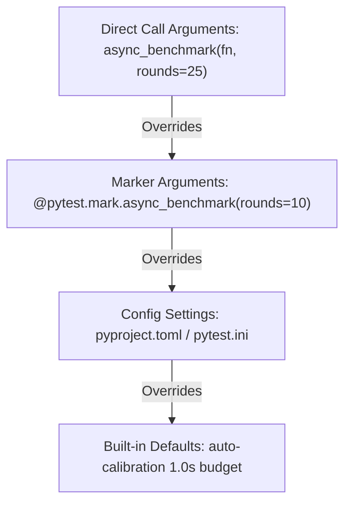

# Dual Interface (Async vs Sync)

`pytest-async-benchmark` provides two distinct interfaces, automatically adapting to your test suite without configuration changes:

1. **Async Interface (`await async_benchmark(...)`)**: Natural async/await syntax when `pytest-asyncio` is installed.
2. **Sync Interface (`async_benchmark(...)`)**: Standard synchronous test syntax when `pytest-asyncio` is not used.

## 1. Async Interface (with pytest-asyncio)

When testing async frameworks such as FastAPI, FastMCP, Quart, or aiohttp, tests are typically decorated with `@pytest.mark.asyncio`:

```python
import asyncio
import pytest


async def fetch_profile(user_id: int):
    await asyncio.sleep(0.003)
    return {"user_id": user_id}


@pytest.mark.asyncio
async def test_profile_async(async_benchmark):
    # Await the benchmark call directly
    result = await async_benchmark(fetch_profile, 42)

    assert result["p95"] < 0.006
    assert result["ops"] > 150
```

### Advantages of the Async Interface
- Shares fixtures with other async tests.
- Reuses the active `pytest-asyncio` event loop.
- Supports native `await` inside benchmarks, setup, and teardown hooks.

## 2. Sync Interface (without pytest-asyncio)

If your test suite does not use `pytest-asyncio`, you can still benchmark asynchronous coroutines from standard synchronous test functions. The fixture handles event loop execution under the hood:

```python
import asyncio
import pytest


async def fetch_profile(user_id: int):
    await asyncio.sleep(0.003)
    return {"user_id": user_id}


def test_profile_sync(async_benchmark):
    # Notice: def test_..., and no await keyword!
    result = async_benchmark(fetch_profile, 42)

    assert result["p95"] < 0.006
    assert result["ops"] > 150
```

## Parameter Precedence

You can configure benchmark parameters at two levels:
1. **Marker Syntax (`@pytest.mark.async_benchmark`)**: Applied declaratively to the test function.
2. **Call Syntax (`async_benchmark(..., rounds=..., ...)`)**: Passed dynamically to the fixture invocation.

**Call arguments always take precedence over marker parameters.**

```python
@pytest.mark.asyncio
@pytest.mark.async_benchmark(rounds=10, iterations=5, max_time=2.0)
async def test_precedence(async_benchmark):
    # Marker defaults: rounds=10, iterations=5, max_time=2.0

    # Overridden dynamically at call time:
    result = await async_benchmark(fetch_profile, 42, rounds=25)

    assert result["rounds"] == 25  # Overridden!
    assert result["iterations"] == 5  # Inherited from marker
```

### Precedence Hierarchy


