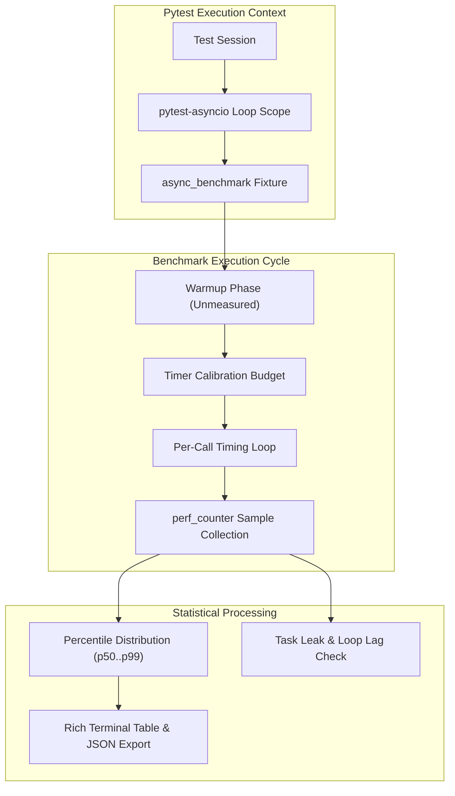

# How It Works

Measuring asynchronous code accurately in Python presents challenges that traditional benchmarking frameworks (like `pytest-benchmark` or standard `timeit`) were not designed to solve.

## The Async Benchmarking Challenge

When benchmarking synchronous code, `timeit` simply measures the wall-clock duration of a function call in a tight loop.

When attempting to measure coroutines with traditional synchronous harnesses, developers usually resort to one of two patterns:

```python
# Anti-Pattern 1: asyncio.run inside the loop
def benchmark_with_sync_runner():
    # DISASTER: creates and destroys an event loop on EVERY call!
    # Measurements capture loop initialization, thread pool teardown,
    # and OS selector registration rather than code latency.
    asyncio.run(my_coroutine())


# Anti-Pattern 2: Timing asyncio.gather in one batch
async def benchmark_batch():
    # Hides variance: you get one aggregated duration for N calls,
    # obliterating min, max, p95, and p99 distribution insight.
    start = time.perf_counter()
    await asyncio.gather(*(my_coroutine() for _ in range(100)))
    total = time.perf_counter() - start
```

### Why Synchronous Harnesses Distort Measurements

1. **Loop Churn Overhead**: Creating an `asyncio` event loop takes between 100 µs and 2 ms depending on the OS and platform selector. If your coroutine takes 50 µs, loop setup dominates 90% of your measurement.
2. **Context and State Loss**: When a loop is destroyed between calls, keep-alive HTTP connection pools, database client connection state, and asyncio task contexts are wiped out.
3. **Event Loop Distortions**: Running an unmanaged sync loop over coroutines fails to measure cooperative scheduling delays and event-loop lag.

## The pytest-async-benchmark Architecture

`pytest-async-benchmark` executes coroutines directly within the active test event loop:



### 1. Warmup Isolation

Every benchmark begins with an unmeasured warmup iteration. This ensures:
- Python bytecode is compiled and loaded into CPU cache.
- Dynamic modules or database connection pools complete initial handshakes.
- JIT compilers (e.g. PyPy) compile hot paths.

The warmup duration is recorded in `result["warmup_time"]` but completely excluded from all statistical calculations (`mean`, `median`, `p95`, `ops`).

### 2. High-Precision Per-Call Sampling

Unlike frameworks that measure only round aggregates (`round_time / iterations`), `pytest-async-benchmark` measures **every individual call** with monotonic nanosecond resolution (`time.perf_counter()`).

This produces an array of individual invocation timings stored in `result["samples"]`. From these samples, true non-parametric percentiles (`p50`, `p75`, `p90`, `p95`, `p99`) are computed directly.

### 3. Loop Lag Monitoring

In asynchronous applications, a slow endpoint or blocking CPU call starves other concurrent tasks. During concurrency benchmarking (`async_benchmark.concurrent`), the runner schedules a lightweight heartbeat task on the event loop to record **event loop lag**:

$$\text{Loop Lag} = \text{Actual Callback Time} - \text{Scheduled Callback Time}$$

If a coroutine blocks the event loop with synchronous computation or non-async I/O, loop lag spikes, alerting you that concurrent throughput is impaired.
