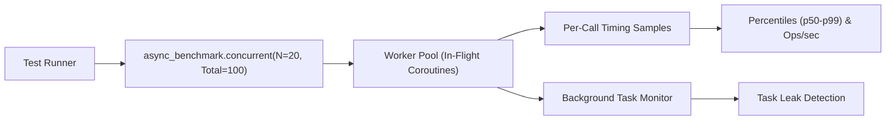

<div class="home-sections">

<section class="home-section">

<p class="eyebrow">Quick Example</p>

## Benchmark async code with natural pytest syntax

Install `pytest-async-benchmark` and benchmark your coroutines with standard pytest fixtures:

```python
import asyncio
import pytest


async def fetch_user_data(user_id: int):
    await asyncio.sleep(0.005)  # simulated network I/O
    return {"id": user_id, "status": "active"}


@pytest.mark.asyncio
async def test_fetch_latency(async_benchmark):
    # Benchmark the coroutine function with auto-calibrated runs
    result = await async_benchmark(fetch_user_data, 42)

    # Assert on real p95/p99 percentiles or throughput
    assert result["p95"] < 0.010
    assert result["ops"] > 100
```

<div class="home-figure">
  
</div>

</section>

<section class="home-section">

<p class="eyebrow">Concurrency Benchmarking</p>

## Measure throughput and event loop lag under real concurrency

Sequential benchmarks tell you how fast code runs in isolation; concurrency benchmarks tell you how it behaves under load.

```python
@pytest.mark.asyncio
async def test_api_concurrency(async_benchmark):
    # Run 100 total requests with 20 requests in flight simultaneously
    stats = await async_benchmark.concurrent(
        fetch_user_data,
        42,
        concurrency=20,
        total=100,
        leak_check=True,
    )

    print(f"Throughput: {stats.ops:.1f} ops/sec")
    print(f"p99 Latency: {stats.p99 * 1000:.2f} ms")
    print(f"Loop Lag: {stats.loop_lag * 1000:.2f} ms")
```



<div class="home-figure">
  
</div>

</section>

<section class="home-section">

<p class="eyebrow">CI Regression Guard</p>

## Catch performance regressions before they land in production

Save historical baselines and prevent silent slowdowns in CI. To eliminate false alarms from noisy cloud runners, `pytest-async-benchmark` applies a one-sided **Mann-Whitney U test** across individual call samples, only failing your pipeline when a regression is both substantive and statistically significant ($p < 0.05$).

```bash
# Compare against baseline and fail if median latency regresses by >10%
pytest --async-bench-compare --async-bench-compare-fail=median:10%
```

<div class="home-figure home-figure-wide">
  
</div>

<div class="capabilities" style="margin-top: 24px;">
  <div class="capability">
    <h3>Zero CI Flakiness</h3>
    <p>Replaces fragile fixed cutoffs with non-parametric Mann-Whitney U testing, ignoring transient VM neighbor spikes.</p>
  </div>
  <div class="capability">
    <h3>Automated Baselines</h3>
    <p><code>--async-bench-autosave</code> records numbered runs in <code>.async_benchmarks/</code> with Git commit SHA and host hardware metadata.</p>
  </div>
  <div class="capability">
    <h3>JSON Export</h3>
    <p>Export all raw percentiles and per-call sample arrays via <code>--async-bench-json</code> for dashboard ingestion and PR comments.</p>
  </div>
</div>

</section>

<section class="home-section">

<p class="eyebrow">From the Author</p>

## Deep dives into async architecture and performance

Articles written by Mihai Farcas on building performant Python architectures, AI agents, and type systems:

<WritingCards />

</section>

<section class="home-section">

<p class="eyebrow">Latest Updates</p>

## What's new in pytest-async-benchmark

<ReleaseHighlights />

</section>

</div>
